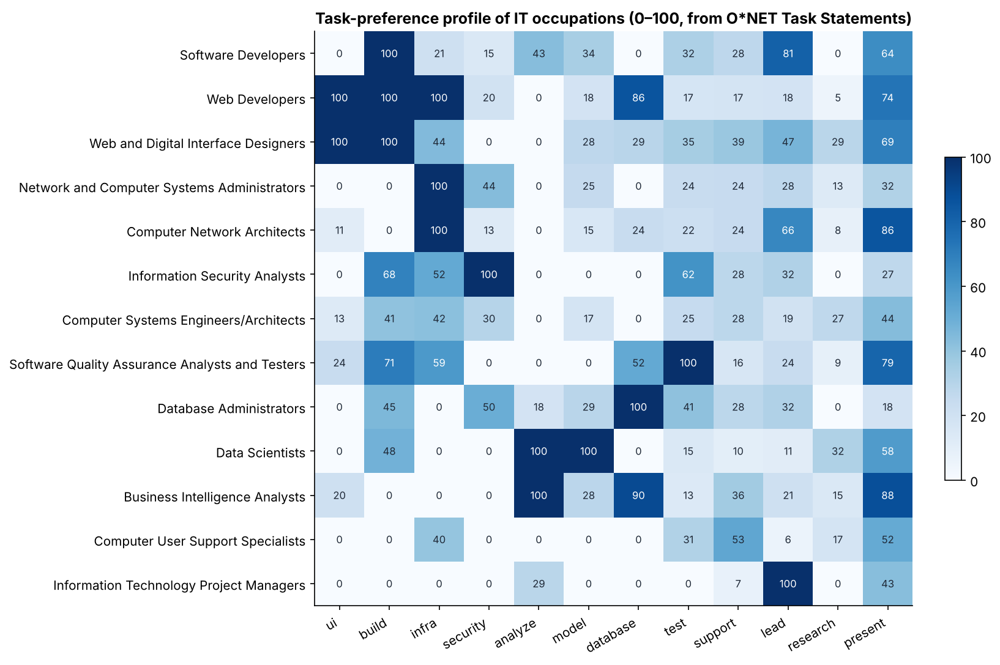
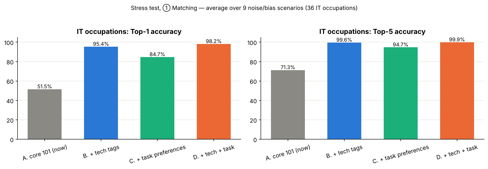
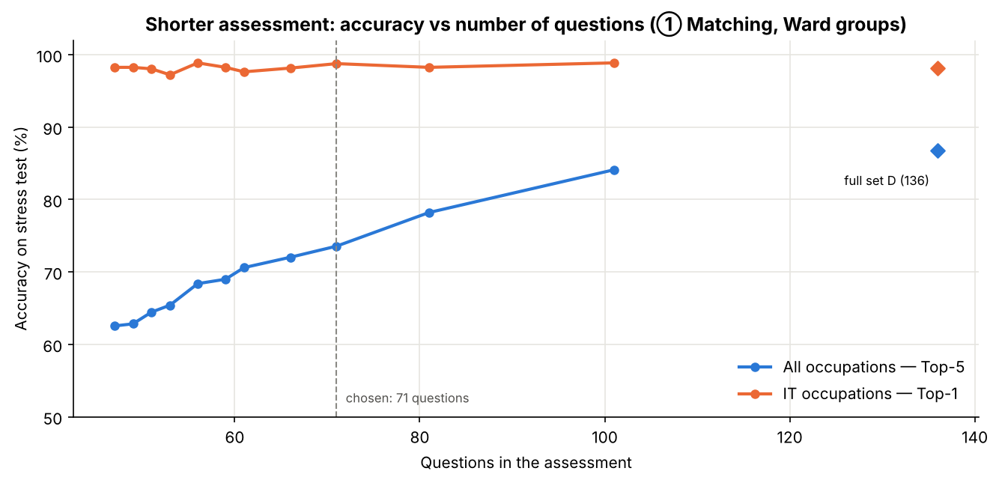
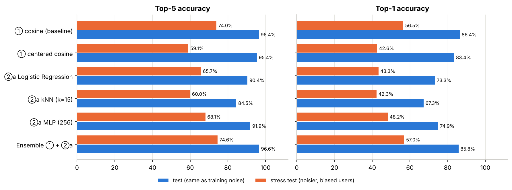
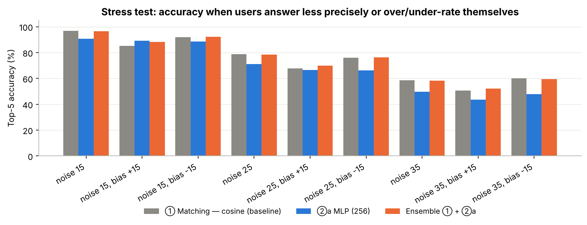

# CareerPath AI — ML Models

ต่อยอดจาก Week 9 Data Gate (`../data_gate_analysis.ipynb`) โดยใช้ข้อมูลที่ clean แล้วใน `../data_gate_output/`
ทุกตัวเลขในไฟล์นี้มาจาก `output/` ที่สคริปต์สร้าง รันซ้ำได้ผลเท่าเดิม (fix random seed)

**ทำ 4 รอบ:**

| รอบ | features / คำถาม | ผลอยู่ที่ | สรุป |
|---|---|---|---|
| 1 | 101 features หลักจาก Data Gate | `output/baseline_core101/` | พบจุดอ่อน: แยกอาชีพสาย IT ไม่ออก |
| 2 | 136 = 101 + tech tags 23 + คำถามความชอบ 12 | `output/full_D136/` | แม่นที่สุด แต่แบบประเมินยาวเกินใช้จริง |
| 3 | 71 ข้อ = กลุ่มทักษะ 30 + RIASEC 6 + ความชอบงาน IT 12 + เครื่องมือ IT 23 | `output/` | สั้นพอใช้จริง แต่เอียงไปทางสาย IT |
| **4 (ใช้จริง)** | **76 ข้อ** = กลุ่มทักษะ 30 + RIASEC 6 + ลักษณะงานทั่วไป 18 + งาน IT 12 + นิสัย 10 | `output/general/` | ทุกสายอาชีพ ตามกลุ่มผู้ใช้ (คนที่ยังไม่รู้ทาง) |

```
ml/
├── task_preferences.py    ← 1) คำถามความชอบจาก Task Statements + เทียบชุด feature
├── short_assessment.py    ← 2) รวม 95 ทักษะเป็น 30 กลุ่ม + คลังคำถาม 71 ข้อ
├── general_assessment.py  ← 3) รอบที่ 4: ลักษณะงานทั่วไป 18 ข้อ + นิสัย 10 ข้อ + เทียบชุดคำถาม + คลังคำถาม 76 ข้อ
├── train_models.py        ← 4) เทรน เปรียบเทียบ เลือกโมเดล วาดกราฟ (ประมาณ 1–2 นาที)
├── evaluation/            ← ประเมินหลายชั้น: persona 28 แบบ, ความเสถียร, ผู้ใช้จริง (ถ้ามี)
├── predict.py             ← เรียกใช้โมเดลจาก backend
├── README.md
└── output/
    ├── general/                          ← รอบที่ 4 (76 ข้อ) — ตัวที่ใช้จริง: models/, คลังคำถาม, ผลเทียบชุดคำถาม
    ├── 01–07_*.csv, figures/, models/   ← รอบที่ 3 (71 ข้อ)
    ├── short/                            ← กลุ่มทักษะ, คลังคำถาม 71 ข้อ, กราฟจำนวนคำถาม vs ความแม่น
    ├── it_focus/                         ← คำถามความชอบ, ผลเทียบชุด feature สาย IT
    ├── full_D136/                        ← ผลรอบที่ 2
    └── baseline_core101/                 ← ผลรอบที่ 1
```

## 0. สรุปสำหรับทำสไลด์ (รอบที่ 4 — ตัวที่เว็บใช้จริง)

> รายละเอียดโมเดล**ทีละตัว** (หน้าที่ · train/test ด้วยอะไร · เทียบกับตัวไหน · ผล · ใช้ที่ไหนบนเว็บ) อยู่ที่ [MODELS.md](MODELS.md)

> ทุกตัวเลขมาจาก `output/general/summary.json` และ `output/general/evaluation/report.json`
> ข้อมูล train/test เป็น **ผู้ใช้จำลอง** ทั้งหมด (ยังไม่มี label จากคนจริง)

### สไลด์ 1 — ภาพรวมระบบ
```
คำตอบ 76 ข้อ (1–5) → คะแนน 0–100 = User Vector 76 มิติ
   ├─ ① Cosine Matching ─┐
   │                     ├─→ Ensemble (0.9 : 0.1) → Top 5 จาก 910 อาชีพ + ความมั่นใจ + อธิบายผล
   ├─ ②a MLP (256) ──────┘
   ├─ ②b kNN (k=15) → กลุ่มอาชีพที่เหมาะ (22 กลุ่ม SOC)
   └─ ③ K-Means (8 กลุ่ม) → อาชีพใกล้เคียง
```
76 ข้อ = กลุ่มทักษะ 30 + ความสนใจ RIASEC 6 + ลักษณะงานที่ชอบ 30 + นิสัยในการทำงาน 10 · ข้อมูลอาชีพ: O*NET 910 อาชีพ

### สไลด์ 2 — โมเดลไหนเทรน โมเดลไหนไม่เทรน
| โมเดล | เทรนไหม | เรียนรู้อะไร | ใช้ทำอะไรบนเว็บ |
|---|---|---|---|
| ① Cosine Matching | ไม่ต้องเทรน | เทียบเวกเตอร์ผู้ใช้กับโปรไฟล์ O*NET ตรง ๆ (ดูทิศทาง ไม่ใช่ขนาด) | ส่วนหลักของการจัดอันดับ |
| **②a MLP (256)** | ✅ supervised | คำตอบ → อาชีพ (910 คลาส) | รวมกับ ① เป็น Ensemble |
| Ensemble | จูนค่า | น้ำหนัก ① : ②a และ softmax T ด้วย grid search | **จัดอันดับ Top 5 จริง** |
| **②b kNN (k=15)** | ✅ supervised | คำตอบ → กลุ่มอาชีพ (22 คลาส) | กลุ่มอาชีพที่เหมาะ |
| **③ K-Means** | ✅ unsupervised | จัดกลุ่ม 910 โปรไฟล์อาชีพ (ไม่มีเฉลย → ไม่มี train/test) | อาชีพใกล้เคียง |

ตั้งค่า: MLP 1 ชั้นซ่อน 256 หน่วย, alpha 0.001, early stopping, StandardScaler (เทรน 9.5 วินาที) · kNN k=15 ให้น้ำหนักตามระยะ · Ensemble w = 0.9, T = 0.01

### สไลด์ 3 — ข้อมูล train / validation / test
ผู้ใช้จำลอง 1 คน = โปรไฟล์อาชีพ X + noise (ตอบคลาดเคลื่อน) + bias (ประเมินตัวเองสูง/ต่ำเกิน) · เฉลย = อาชีพ X

| ชุด | จำนวน | สร้างอย่างไร | ใช้ทำอะไร |
|---|---|---|---|
| Train | 24,570 คน | 6,370 (noise 15) + augmentation 18,200 (noise 5–30, bias ±15) | เทรน ②a, ②b |
| Validation | 1,365 คน | noise 15 | เลือกโมเดล |
| Stress validation | 8,190 คน | 9 สถานการณ์ × 910 อาชีพ (seed 2001) | เลือกโมเดล + จูน Ensemble |
| Test | 1,365 คน | noise 15 | วัดผลแบบง่าย |
| **Stress test** | 8,190 คน | noise 15/25/35 × bias 0/+15/−15 (seed 3001) | **รายงานผลสุดท้ายเท่านั้น** |

แบ่ง 70/15/15 แบบ stratified (seed 42) · ชุด test ไม่ถูกใช้เลือกอะไรเลย · scaler และค่าที่จูนใช้ train/validation เท่านั้น (กัน leakage)

### สไลด์ 4 — ผลจับคู่ 910 อาชีพ
| โมเดล | Test Top-5 | Stress Top-1 | **Stress Top-5** |
|---|---|---|---|
| ① Cosine | 99.3% | 64.4% | 83.0% |
| ① Centered cosine | 99.3% | 48.3% | 69.7% |
| ②a Logistic Regression | 97.7% | 52.3% | 74.3% |
| ②a kNN | 94.4% | 46.4% | 71.2% |
| ②a MLP | 98.0% | 55.5% | 76.8% |
| **Ensemble ① + ②a (ใช้จริง)** | 99.4% | **65.0%** | **83.4%** |

### สไลด์ 5 — ผลทายกลุ่มอาชีพ (②b, 22 กลุ่ม)
| โมเดล | Test | Stress test |
|---|---|---|
| Logistic Regression | 77.3% | 64.5% |
| **kNN (ใช้จริง)** | 92.1% | **73.7%** |
| Random Forest | 78.9% | 62.2% |
| HistGradientBoosting | 84.4% | 66.3% |
| MLP | 89.2% | 68.6% |

### สไลด์ 6 — อ่านผลอย่างไร
1. **Test ง่ายเกินไป** — ทุกโมเดลเกือบ 100% เพราะผู้ใช้จำลองคลาดเคลื่อนน้อย จึงใช้ **stress test เป็นตัวเลขหลัก**
2. **MLP เดี่ยวแม่นน้อยกว่า Cosine** (76.8% vs 83.0%) แต่รวมกัน 0.9 : 0.1 ดีที่สุด — โปรไฟล์ O*NET เป็นข้อมูลที่ดีอยู่แล้ว
3. **Cosine ธรรมดาทน bias ได้ดีกว่าแบบ centered มาก** (83.0% vs 69.7%) เพราะดูรูปแบบคำตอบ ไม่ใช่ระดับ
4. **ข้อจำกัดใหญ่ที่สุด** — train และ test สร้างจากโปรไฟล์ O*NET ชุดเดียวกัน → บอกได้ว่า "ทนต่อคำตอบคลาดเคลื่อนแค่ไหน"
   แต่ **ไม่ได้บอกว่าแม่นกับคนจริงแค่ไหน** (ต้องมีข้อมูลคนจริงที่มีอาชีพเป็นเฉลย)

### สไลด์ 7 — วัดผลเพิ่ม 4 ชั้น
| ชั้น | วัดอะไร | ผล |
|---|---|---|
| 1. Stress test | ทนต่อ noise/bias | Ensemble Top-5 83.4% |
| 2. Persona 28 แบบ (Claude ร่าง) | ผู้ใช้สมมติตามลักษณะคน ได้อาชีพในตระกูลที่ควรได้ไหม | Top 5 ถูกตระกูล 79% (นอกสาย IT 75%) · ②b ถูก 75% |
| 3. ความเสถียร | เปลี่ยน 2 คำตอบ ผลเปลี่ยนแค่ไหน | Top 5 ซ้ำ 90% · อันดับ 1 คงเดิม 91% |
| 4. ผู้ใช้จริง | label จากคนทำงานจริง | ยังไม่มี — ระบบรองรับแล้ว |

### สไลด์ 8 — ต่อยอดจากโมเดล (ไม่เทรนใหม่)
| ส่วน | ทำงานอย่างไร | ผล |
|---|---|---|
| อธิบายผล | แยกคะแนน ① เป็นรายคำถาม — ผลรวม = คะแนนจริงพอดี (ไม่ใช่การประมาณ) | บอกข้อที่ดันขึ้น / ดึงลง |
| ความมั่นใจ | calibrate กับผู้ใช้จำลองชุดใหม่ 8,190 คน (ตอบ 1–5) | มั่นใจสูงสุด → อันดับ 1 ถูก 98% · ต่ำสุด → 22% · ① กับ ②a เห็นตรงกัน → 83% |
| Counterfactual | เปลี่ยนคำตอบน้อยที่สุดเท่าไร อาชีพเป้าหมายจึงเข้า Top 5 (Ensemble จัดอันดับใหม่ทุกขั้น) | เป้าหมายอันดับ 20: พัฒนาทักษะอย่างเดียวถึง 36% · ถ้าความชอบตรงด้วย 100% |
| อาชีพในสายที่เรียน | ตาราง CIP–SOC ของ NCES + Ensemble จัดอันดับในสาย | 97 สาขา, เชื่อม 588/910 อาชีพ |

สูตรที่กำหนดเอง (ไม่ใช่ ML): ทักษะครอบคลุม % และ Skill Priority = Gap × (1 + 0.5·O*NET importance + 0.5·distinctiveness)

### สไลด์ 9 — ข้อค้นพบและข้อจำกัด
- โมเดลให้น้ำหนัก **ความชอบและนิสัย** มาก (46 จาก 76 ข้อ) — พัฒนาทักษะอย่างเดียวมักไม่พอให้อาชีพที่ลักษณะงานต่างจากที่ชอบเข้า Top 5
- ทาย **ตระกูลอาชีพ** แม่นกว่าทายรหัสตรง ๆ เพราะ 910 อาชีพมีหลายคู่ที่เกือบเหมือนกัน
- รอบ 4 แลกความแม่นสาย IT (Top-1 97.2% → 85.2%) กับอาชีพอื่น 874 อาชีพที่แม่นขึ้น (Top-5 74.6% → 83.4%)
- ข้อมูล O*NET เป็นของสหรัฐฯ · persona, ชื่อไทย และการจับคู่สาขาไทยร่างโดย Claude — ควรให้ผู้รู้ตรวจ
- ทุกตัวเลขมาจากผู้ใช้จำลอง — ยังไม่ได้วัดกับคนจริง

**กราฟสำหรับสไลด์:** `output/general/figures/` — 01 เทียบโมเดล · 02 stress test แยกสถานการณ์ · 03 กลุ่มอาชีพ · 04 silhouette · 05 แผนที่อาชีพ PCA · 06 permutation importance

## วิธีรัน

```bash
cd datasets/ml
pip install -r requirements-train.txt          # scikit-learn 1.9.1 ต้องตรงกับ backend
python task_preferences.py
python short_assessment.py
python general_assessment.py
python train_models.py --feature-set general --out output/general     # รอบที่ 4 (ใช้จริง)
python evaluation/evaluate.py                                          # persona + ความเสถียร + ผู้ใช้จริง (ถ้ามี)
python train_models.py --feature-set short                             # รอบที่ 3
python train_models.py --feature-set D    --out output/full_D136        # รอบที่ 2
python train_models.py --feature-set core --out output/baseline_core101 # รอบที่ 1
python predict.py                                                       # ทดสอบกับผู้ใช้ตัวอย่าง
```

---

## 1. สรุปผลรอบที่ 1–3 (stress test) — ประวัติ ดูรอบที่ 4 ที่ส่วน 0 และ 4b

| | รอบที่ 1 (101) | รอบที่ 2 (136) | **รอบที่ 3 (71)** |
|---|---|---|---|
| ① Matching Top-5 | 74.0% | 86.7% | 74.0% |
| ②a Classifier (MLP) Top-5 | 69.1% | 82.7% | 68.1% |
| **Ensemble ① + ②a Top-5** | 75.8% | 88.2% | **74.6%** |
| Ensemble Top-1 | 54.6% | 73.0% | 57.0% |
| Ensemble Top-5 ระดับกลุ่มอาชีพ | 91.6% | 96.1% | 89.1% |
| **สาย IT Top-1** (① Matching) | 51.5% | 98.2% | **98.8%** |
| น้ำหนัก ensemble (① : ②a) | 0.9 : 0.1 | 0.8 : 0.2 | 0.9 : 0.1 |
| ②b Group Classifier | MLP · Macro-F1 56.9% | kNN · 66.9% | kNN · 58.6% |
| ③ Clustering | K-Means 9 กลุ่ม | K-Means 8 กลุ่ม | K-Means 15 กลุ่ม |

**ข้อสรุป:** แบบประเมิน 71 ข้อแม่นกับอาชีพทั่วไปพอ ๆ กับรอบที่ 1 ที่ถาม 101 ข้อ แต่ใช้คำถามน้อยกว่า 30 ข้อ และแยกสาย IT ได้ดีเท่ารอบที่ 2 ซึ่งตรงกับกลุ่มเป้าหมายหลัก ถ้าต้องการความแม่นกับอาชีพทุกสายมากขึ้น ใช้รอบที่ 2 (136 ข้อ) แลกกับแบบประเมินที่ยาวขึ้นเกือบเท่าตัว

บน test เดิม (ผู้ใช้จำลองแบบเดียวกับ train) ทุกรอบได้ Top-5 สูงกว่า 96% ซึ่งสูงเกินจริงตามที่ Data Gate ข้อ 5.2 ชี้ไว้ จึงรายงาน stress test เป็นหลัก

## 2. ชุดข้อมูลและวิธีวัดผล

| ชุด | จำนวน | ที่มา | ใช้ทำอะไร |
|---|---|---|---|
| Reference | 910 อาชีพ | โปรไฟล์อาชีพจาก O*NET ตามชุด feature ของแต่ละรอบ | ฐานข้อมูลอาชีพ |
| Train | 24,570 คน | ผู้ใช้จำลองแบบ Data Gate 6,370 คน + **augmentation 18,200 คน** (noise SD 5–30, bias −15 ถึง +15) | เทรน ②a ②b |
| Validation | 1,365 + 8,190 คน | แบบ Data Gate + stress validation | เลือกโมเดลและน้ำหนัก ensemble |
| Test | 1,365 คน | แบบ Data Gate (noise 15, ไม่มี bias) | รายงานผล |
| **Stress test** | 8,190 คน | 9 สถานการณ์ × 910 อาชีพ (noise 15/25/35 × bias 0/+15/−15), seed แยก | รายงานผลเมื่อผู้ใช้ตอบไม่แม่น |

รอบที่ 1 ใช้ไฟล์ผู้ใช้จำลองของ Data Gate ตรง ๆ รอบที่ 2 และ 3 สร้างใหม่ด้วยวิธีเดียวกับ notebook (10 คนต่ออาชีพ, noise 15, แบ่ง 70/15/15 stratified, seed 42) เพราะมี feature เพิ่ม

**Metrics:** Top-1, **Top-5** (metric หลัก เพราะเว็บแสดง 5 อาชีพ), Top-5 ระดับกลุ่มอาชีพ, Macro-F1
**การกัน leakage:** scaler, ค่า mean/std ของ matching, น้ำหนัก ensemble และการเลือกโมเดล ใช้ train/validation เท่านั้น

## 3. จุดอ่อนรอบที่ 1 และการแก้ (รอบที่ 2)

อาชีพสาย IT 36 อาชีพมีโปรไฟล์ 101 features คล้ายกันมาก (cosine เฉลี่ยในสาย IT 0.946 เทียบกับ 0.853 ของทุกอาชีพ) ระบบจึงแยก Software Developer, Network Admin และ Data Scientist ออกจากกันได้ไม่ดี ทั้งที่นักศึกษา IT คือกลุ่มเป้าหมายหลัก

**แก้ 2 ทาง:**
1. **คำถาม "ชอบทำงานแบบไหน" 12 ข้อ** คะแนนของอาชีพ = สัดส่วนงานใน O*NET Task Statements ที่ตรงคำสำคัญ (Core = 1, Supplemental = 0.5) ปรับเป็น 0–100 คำสำคัญปรับจาก sanity check ให้อาชีพที่ได้คะแนนสูงสุดตรงกับคำถาม (`it_focus/sanity_top_it_occupations.csv`)
2. **tech tags 23 ตัว** ถามว่า **"อยากทำงานกับเครื่องมือนี้แค่ไหน"** ไม่ใช่ "ใช้เป็นไหม" เพราะ tag ของอาชีพหมายถึงงานนั้นใช้เครื่องมือนี้ และนักศึกษา IT เกือบทุกคนใช้ Python และ SQL เป็น





| ชุด feature (① Matching, เฉพาะสาย IT) | คำถาม | cosine เฉลี่ยในสาย IT | IT Top-1 | IT Top-5 |
|---|---|---|---|---|
| A. core 101 (รอบที่ 1) | 101 | 0.946 | 51.5% | 71.3% |
| B. + tech tags | 124 | 0.840 | 95.4% | 99.6% |
| C. + ความชอบ | 113 | 0.886 | 84.7% | 94.7% |
| D. + tech + ความชอบ (รอบที่ 2) | 136 | 0.814 | 98.2% | 99.9% |

ผลละเอียดของรอบที่ 2 (ตาราง กราฟ โมเดล) อยู่ใน `output/full_D136/`

## 4. แบบประเมินฉบับสั้น (รอบที่ 3)

**ปัญหา:** 136 ข้อยาวเกินไป ผู้ใช้จะเลิกกลางทาง และ 101 features หลักยังไม่มีคำถามเลย

**แนวทาง:** 95 ทักษะ (Abilities 52, Knowledge 33, Essential Skills 10) หลายตัวขึ้นลงพร้อมกันข้ามอาชีพ จึงจัดกลุ่มแล้วถาม 1 ข้อต่อกลุ่ม คะแนนกลุ่มของอาชีพ = ค่าเฉลี่ยของทักษะในกลุ่ม

- **วิธีจัดกลุ่ม:** hierarchical clustering แบบ **Ward** (ทักษะแต่ละตัวเป็นจุด โปรไฟล์ข้าม 910 อาชีพ z-score) เทียบกับ average linkage บน 1 − correlation ซึ่งแม่นกว่าราว 1–3 จุดที่จำนวนคำถามเท่ากัน แต่ได้กลุ่มยักษ์ 25–26 ทักษะ (ถามเป็นคำถามเดียวไม่ได้) และกลุ่มเดี่ยวเยอะ ส่วน Ward กลุ่มใหญ่สุดมี 10 ทักษะ
- **จำนวนกลุ่ม:** ทดลอง 6–60 กลุ่ม (`short/12_questions_vs_accuracy.csv`) เลือก **30 กลุ่ม** = แบบประเมินรวม **71 ข้อ**



| คำถามรวม | ทุกอาชีพ Top-5 | สาย IT Top-1 |
|---|---|---|
| 47 (6 กลุ่ม) | 62.6% | 98.3% |
| 61 (20 กลุ่ม) | 70.6% | 97.6% |
| **71 (30 กลุ่ม, เลือก)** | **73.6%** | **98.8%** |
| 81 (40 กลุ่ม) | 78.2% | 98.3% |
| 101 (60 กลุ่ม) | 84.1% | 98.9% |
| 136 (ไม่รวมกลุ่ม) | 86.7% | 98.1% |

(① Matching บน stress test 9 สถานการณ์ × 3 seeds)

สาย IT แม่นคงที่แม้คำถามน้อยลง เพราะคำถามความชอบและเครื่องมือรับภาระแยกสาย IT ไว้แล้ว ส่วนอาชีพสายอื่นต้องพึ่งคำถามทักษะมากกว่า

**คลังคำถาม 71 ข้อ** (`output/short/question_bank_short.csv`): ตอบ 1–5 แล้วแปลงเป็น (คำตอบ − 1) ÷ 4 × 100

| ส่วน | จำนวน | ตัวอย่าง |
|---|---|---|
| 1. ทักษะและความรู้ | 30 | คำนวณ ใช้ตัวเลข และแก้โจทย์คณิตศาสตร์ได้ดีแค่ไหน |
| 2. ความสนใจ (RIASEC) | 6 | ชอบงานค้นคว้า วิเคราะห์ และหาคำตอบของปัญหาแค่ไหน |
| 3. ลักษณะงานที่ชอบ | 12 | ชอบดูแลเซิร์ฟเวอร์ เครือข่าย และระบบให้ทำงานได้ไม่ล่ม |
| 4. เครื่องมือที่อยากใช้ทำงาน | 23 | อยากทำงานกับ Docker เป็นประจำแค่ไหน |

ทักษะในแต่ละกลุ่มดูได้ที่ `output/short/skill_groups.csv` เช่น กลุ่ม "ตัวเลขและคณิตศาสตร์" = Mathematical Reasoning, Number Facility, Mathematics (Knowledge), Mathematics (Skill)

### ผลละเอียดรอบที่ 3 (`01_occupation_model_comparison.csv`)




| โมเดล | Test Top-5 | Stress Top-5 | Stress Top-1 | Stress Macro-F1 |
|---|---|---|---|---|
| ① Cosine | 96.4% | 74.0% | 56.5% | 55.2% |
| ②a MLP (256) | 91.9% | 68.1% | 48.2% | 48.3% |
| **Ensemble ① + ②a** | 96.6% | **74.6%** | **57.0%** | **55.7%** |

②b เลือก kNN (k = 15) Macro-F1 80.0% บน test และ 58.6% บน stress test (`02_major_group_model_comparison.csv`)
③ K-Means 15 กลุ่ม, silhouette 0.110, ARI กับกลุ่มอาชีพ SOC 0.301 — Data Scientists กับ Software Developers อยู่กลุ่มเดียวกัน ส่วน Network and Computer Systems Administrators และ Accountants แยกกลุ่มของตัวเอง

---

## 4b. รอบที่ 4: ทุกสายอาชีพ (ใช้จริง, 12 พ.ย. 2026)

**เหตุผล:** กลุ่มผู้ใช้คือคนที่ยังไม่มีทิศทางอาชีพ (จบแล้วยังไม่มีงาน, ไม่รู้ว่าเก่งอะไร/อยากเป็นอะไร) ไม่ใช่นักศึกษา IT
แต่แบบประเมินรอบที่ 3 มีคำถามเรื่อง IT 35 จาก 71 ข้อ — เครื่องมือ IT 23 ข้อ (Kubernetes, Spark …) คนนอกสายตอบไม่ได้
และ persona นอกสาย IT ได้ผลแย่

**สิ่งที่เปลี่ยน** (`general_assessment.py`):
- ตัดเครื่องมือ IT 23 ข้อ
- เพิ่ม **ลักษณะงานที่ชอบ 18 ข้อทุกสาย** (`gtask::` ดูแลคน สอน ขาย บริการ บริหาร เอกสาร การเงิน วิเคราะห์ คอมพิวเตอร์
  ซ่อม/สร้าง ขับ/คุมเครื่องจักร ธรรมชาติ ศิลปะ เขียน อาหาร ความปลอดภัย รักษา ผลิต) คำนวณจาก Task Statements วิธีเดียวกับรอบ 2–3
- เพิ่ม **นิสัยในการทำงาน 10 ข้อ** (`ws::` จาก O*NET Work Styles เลือกด้านที่ต่างกันระหว่างอาชีพมาก) — ตอบง่ายกว่าประเมินฝีมือตัวเอง
- คงคำถามงาน IT 12 ข้อ (เป็นคำถาม "ชอบ…ไหม" คนนอกสายตอบได้) — ถ้าตัดออก สาย IT แยกกันไม่ออก
  (12 พ.ย.: บนเว็บ/ฟอร์มย้ายไปอยู่ในหมวด "ลักษณะงานที่ชอบ" ไม่แยกหัวข้อ IT — feature และโมเดลเดิม · ชุด B → C นอกสาย IT Top-5 ก็ดีขึ้น 39.8% → 48.2%)
- เครื่องมือที่อาชีพใช้ยังแนะนำใน Roadmap ได้ (อ่านจาก `models/tools_reference.csv`)

**เลือกชุดคำถาม** (`output/general/13_round4_comparison.csv`, ① Matching อย่างเดียว ใช้เทียบระหว่างชุด):
ชุดที่มีงาน IT 12 ข้อ (76 ข้อ) ดีที่สุดเมื่อดูทั้ง stress test และ persona — ชุด "ถามงาน IT เฉพาะคนชอบคอมพิวเตอร์"
persona ใกล้เคียงกันแต่ stress test ตกมาก, ชุดที่ใส่เครื่องมือ IT กลับทำให้ persona นอกสาย IT แย่ลง

**ผลโมเดลจริง (Ensemble) รอบ 3 → รอบ 4**

| วัดด้วย | รอบ 3 (71 ข้อ) | รอบ 4 (76 ข้อ) |
|---|---|---|
| Stress test Top-1 / Top-5 (ทุกอาชีพ) | 57.0% / 74.6% | **65.0% / 83.4%** |
| Stress test สาย IT Top-1 | 97.2% | 85.2% ↓ |
| Stress test นอกสาย IT Top-1 / Top-5 | 55.6% / 73.4% | **64.2% / 83.0%** |
| Persona 28 แบบ — ตระกูลอาชีพ SOC ถูกใน Top 5 | 61% | **79%** |
| Persona นอกสาย IT (16) — soc / ตรงรหัส ใน Top 5 · อันดับกลาง | 50% / 31% · 14 | **75% / 62% · 3** |
| Persona สาย IT (12) — soc ใน Top 5 | 75% | 83% |
| ②b กลุ่มอาชีพถูก (persona) | 25% | **75%** |
| ความเสถียร: เปลี่ยน 2 คำตอบ Top 5 ซ้ำ / อันดับ 1 คงเดิม | 85% / 83% | 90% / 91% |

ราคาที่จ่าย: สาย IT Top-1 ใน stress test ลดลง 12 จุด (แต่ persona สาย IT ดีขึ้น) — คุ้มเพราะอาชีพนอกสาย IT คือ 874 จาก 910
persona ที่ยังพลาด: nurse, hr, electrician, preschool_teacher, it_pm, it_support (`output/general/evaluation/report.json`)

> persona 28 แบบร่างโดย Claude (12 แบบใหม่เขียนก่อนเห็นผลรอบ 4) ควรให้ผู้รู้ตรวจ · ทุกตัวเลขยังมาจากผู้ใช้จำลอง/persona ไม่ใช่คนจริง

## 5. สิ่งที่พบ (ใช้อธิบายตอนนำเสนอ)

1. **เพิ่มคำถามที่ถูกต้อง สำคัญกว่าเปลี่ยนอัลกอริทึม** รอบที่ 2 เพิ่ม 35 คำถาม ทุกโมเดลดีขึ้น 12–14 จุดบน stress test มากกว่าความต่างระหว่างอัลกอริทึมในรอบเดียวกัน
2. **ความแม่นต้องแลกกับความยาวแบบประเมิน** ลดจาก 136 เหลือ 71 ข้อ ทุกอาชีพ Top-5 ลดจาก 86.7% เหลือ 73.6% (① Matching) แต่สาย IT ไม่ลดเลย จึงเลือกฉบับสั้นเพราะกลุ่มเป้าหมายหลักคือนักศึกษา IT
3. **บนข้อมูลจำลอง ① Matching ชนะ ②a Classifier ทุกรอบ** เพราะผู้ใช้จำลองคือโปรไฟล์ O*NET บวก noise การเทียบโปรไฟล์ตรง ๆ ได้เปรียบโดยธรรมชาติ Ensemble ยังช่วยได้เล็กน้อยทุกรอบ และช่วยชัดเมื่อผู้ใช้ประเมินตัวเองสูงเกินจริง
4. **ทายอาชีพย่อยพลาด แต่สายงานยังถูก:** Top-5 ระดับกลุ่มอาชีพของ Ensemble 89–96% ทุกรอบ
5. **Random Forest / Boosting ไม่ใช้กับ 910 อาชีพ** เพราะแต่ละต้นต้องเก็บความน่าจะเป็น 910 ค่าทุก node และ boosting ต้องสร้าง 910 ต้นต่อรอบ จึงทดสอบที่ระดับ 22 กลุ่ม (②b) แทน ซึ่ง RF แย่ที่สุดทุกรอบ
6. **Clustering ไม่คม** (silhouette 0.110–0.135 ทุกรอบ) ปกติสำหรับข้อมูลหลายมิติที่อาชีพกระจายต่อเนื่อง จึงใช้ทำแผนที่อาชีพและหาอาชีพใกล้เคียง ไม่ใช้ตัดสินใจหลัก

## 6. ข้อจำกัด

- **ยังไม่มีผลกับคนจริง** ทุกตัวเลขมาจากผู้ใช้จำลอง ต้องวัดผลซ้ำกับ real-user test set
- **คำถามรวมกลุ่มตั้งอยู่บนข้อสมมติ** ว่าผู้ใช้ตอบ 1 คำถามแทนค่าเฉลี่ยของทักษะทั้งกลุ่มได้ และคำถามความชอบสัมพันธ์กับงานที่อาชีพทำบ่อย ต้องทดสอบว่าผู้ใช้เข้าใจคำถามตรงกัน
- **ฉบับสั้นแม่นกับอาชีพนอกสาย IT น้อยกว่าชุดเต็ม** (Ensemble Top-5 74.6% เทียบกับ 88.2%)
- **②a มั่นใจเกินจริง** ความน่าจะเป็นของ MLP มักใกล้ 1 หรือ 0 จึงใช้ `skill_coverage_percent` เป็นตัวเลขที่แสดงผู้ใช้
- ข้อจำกัดด้านข้อมูลอื่น ๆ (ตลาดแรงงานสหรัฐฯ, ไม่มีชื่ออาชีพ DevOps / ML Engineer แยก) ตาม `../data_gate_output/05_limitations.csv`

## 7. การใช้ในเว็บแอป (`predict.py`)

```python
from predict import CareerPredictor

cp = CareerPredictor("output/models")
user = {"grp::numbers": 75, "ri::Investigative": 100, "task::infra": 50, "tech::Docker": 100, ...}   # 71 ข้อ, 0–100

cp.recommend(user)                     # Top 5 อาชีพ + คะแนนจาก ① ②a + กลุ่มอาชีพ ②b + cluster ③
cp.skill_gap(user, "15-2051.00")       # Skill Gap 30 กลุ่มทักษะ (ชื่อภาษาไทย) + Skill Priority + เครื่องมือที่อาชีพใช้
cp.similar_careers("15-2051.00")       # อาชีพใกล้เคียงจาก ③
```

ลำดับ feature อยู่ใน `output/models/model_config.json` (`feature_order`) และคำถามของแต่ละ feature อยู่ใน `output/short/question_bank_short.csv`

| ค่าที่ `recommend` คืน | มาจาก | ใช้ทำอะไร |
|---|---|---|
| `rank` | Ensemble ① + ②a | ลำดับที่แสดง |
| `skill_coverage_percent` | ผลรวม min(ผู้ใช้, ที่ต้องการ) ÷ ผลรวมที่ต้องการ เฉพาะกลุ่มทักษะ | **ตัวเลข % บนการ์ดอาชีพ** |
| `matching_similarity` | ① | กล่อง "คะแนนจากแต่ละโมเดล" |
| `classifier_probability` | ②a | กล่อง "คะแนนจากแต่ละโมเดล" |
| `cluster` | ③ | กลุ่มอาชีพตามทักษะ |

**Skill Gap** นับเฉพาะ 30 กลุ่มทักษะ ไม่นับความสนใจ เครื่องมือที่อยากใช้ และความชอบ เพราะไม่ใช่สิ่งที่ "ขาด"
`priority = gap × (1 + 0.5 × O*NET importance + 0.5 × distinctiveness)` (importance ของกลุ่ม = ค่าเฉลี่ยของทักษะในกลุ่ม) และ `tools_used` บอกเครื่องมือที่อาชีพนั้นใช้ เอาไปทำ Learning Roadmap ต่อ

ตัวอย่างผลจริงจาก `python predict.py` (ผู้ใช้จำลองจากโปรไฟล์ Data Scientists + noise 15):

```
#1  ครอบคลุม 79.5%  Data Scientists                               ①=0.984
#2  ครอบคลุม 67.8%  Computer and Information Research Scientists  ①=0.934
#3  ครอบคลุม 78.3%  Software Developers                           ①=0.911
#4  ครอบคลุม 79.7%  Financial Quantitative Analysts               ①=0.870
#5  ครอบคลุม 71.3%  Database Administrators                       ①=0.888
กลุ่มอาชีพ (②b): Computer & Mathematical
Skill Gap อันดับ 1: การจับรูปแบบ (gap 37.8)
```

## 8. ขั้นต่อไป

1. ทดลองแบบประเมิน 71 ข้อกับผู้ใช้จริงกลุ่มเล็ก: ใช้เวลากี่นาที เข้าใจคำถามตรงกันไหม
2. เก็บ real-user test set จากคนทำงานจริง 50–100 คน แล้ววัดผลด้วย metrics ชุดเดียวกัน
3. พิจารณาแบบประเมิน 2 ขั้น: ถามฉบับสั้นก่อน แล้วถามละเอียดเฉพาะสายที่ผู้ใช้น่าจะเหมาะ
4. นำ `reference_vectors.csv` เข้า PostgreSQL + pgvector สำหรับ ① และโหลด `.joblib` ใน FastAPI สำหรับ ②

ข้อมูลจาก O*NET Resource Center (U.S. Department of Labor) สัญญาอนุญาต CC BY 4.0

## 4c. อธิบายผล + ความมั่นใจของโมเดล (ระยะ 2, 12 พ.ย.)

**อธิบายผล (`CareerPredictor.explain`, `POST /api/explain`)** — แยกคะแนน ① Cosine เป็นรายคำถาม
`contribution_j = x̂_j (r̂_j − r̄_j)` (x̂, r̂ = เวกเตอร์ความยาว 1, r̄ = ค่าเฉลี่ย r̂ ของ 910 อาชีพ)
ผลรวมทุกข้อ = cos(ผู้ใช้, อาชีพนี้) − cos เฉลี่ยกับทุกอาชีพ **พอดี** (ไม่ใช่การประมาณแบบ SHAP/LIME) · อธิบายเฉพาะ ① (น้ำหนัก 0.9)
ส่วน ②a MLP (0.1) ไม่ได้แยก

**ความมั่นใจ (`calibrate_confidence.py` → `models/confidence_calibration.json`)** — ผู้ใช้จำลองชุดใหม่ 8,190 คน
(9 สถานการณ์เดียวกับ stress test, seed 4001 ไม่ซ้ำชุดเทรน/ทดสอบ, **ปัดคำตอบเป็น 1–5** เหมือนคนจริง)
แบ่งคะแนน Ensemble ของอันดับ 1 เป็น 5 ช่วงเท่า ๆ กัน:

| คะแนนอันดับ 1 | ระดับ | Top-1 | Top-5 |
|---|---|---|---|
| 0.044–0.176 | ต่ำ | 22.2% | 54.3% |
| 0.176–0.291 | ต่ำ | 39.9% | 73.1% |
| 0.291–0.487 | ปานกลาง | 66.7% | 87.9% |
| 0.487–0.771 | สูง | 86.6% | 95.8% |
| 0.771–1.000 | สูง | 98.1% | 99.1% |

① กับ ②a เลือกอันดับ 1 ตรงกัน 56.7% ของผู้ใช้จำลอง → Top-1 82.5% · ไม่ตรงกัน → 36.8%
ปัดเป็น 1–5 ทำให้ Top-1 รวมลดจาก 64.8% เหลือ 62.7% · ยังเป็นผู้ใช้จำลอง: บอกได้ว่า "คะแนนสูง = น่าเชื่อกว่า"
แต่ % จริงกับคนอาจต่างไป — เทสต์ `test_confidence_calibrated` ตรวจว่าความแม่นเพิ่มตามช่วงคะแนนเสมอ

## 4d. อาชีพที่อยากเป็น + Counterfactual explanation (12 พ.ย.)

ผู้ใช้เลือกอาชีพเป้าหมายเองจาก 910 อาชีพ (หน้า `/goal`, `POST /api/target`) → อันดับตาม Ensemble + แยกคะแนน ① + counterfactual:
"เปลี่ยนคำตอบน้อยที่สุดเท่าไร อาชีพนี้จึงเข้า Top 5" (`CareerPredictor.counterfactual`)

- ค้นแบบ greedy ทีละ 1 ระดับคำตอบ (+/−25) เลือกข้อที่ทำให้ `log E_target − log E_อันดับ5` ดีขึ้นมากที่สุด
  ทุกอันดับคำนวณด้วย Ensemble ตัวจริง · หยุดเมื่อเข้า Top 5 / ไม่มีข้อไหนช่วย / ครบ 15 (skills) หรือ 25 (all) ระดับ
- `skills`: เพิ่มเฉพาะกลุ่มทักษะ (grp::) ที่อาชีพต้องการสูงกว่าปัจจุบัน — สิ่งที่ฝึกได้จริง
- `all`: ขยับความสนใจ/ลักษณะงาน/นิสัยเข้าหาโปรไฟล์อาชีพได้ด้วย — ใช้บอกว่า "ส่วนไหนต่าง" ไม่ใช่คำแนะนำให้เปลี่ยนนิสัย
- greedy ไม่รับประกันว่าน้อยที่สุดจริง (ไม่ใช่ optimal) แต่ทุกผลตรวจซ้ำกับ `recommend()` ได้

ผลกับ persona 28 แบบ (`evaluate.py` → `report.json["counterfactual"]`):

| เป้าหมาย (อันดับเดิม) | skills: เข้า Top 5 | อันดับกลางหลังเปลี่ยน | all: เข้า Top 5 | ระดับที่ใช้ (กลาง) |
|---|---|---|---|---|
| 20 | 36% | 12 | 100% | 3 |
| 100 | 0% | 42 | 100% | 9 |
| 400 | 0% | 202 | 100% | 14 |

**ข้อค้นพบ:** โมเดลให้น้ำหนักความชอบ/นิสัย (46 จาก 76 มิติ) มาก — พัฒนาทักษะอย่างเดียวขยับอันดับได้จริง
(เช่น 100 → 42) แต่ไม่พอให้อาชีพที่ลักษณะงานต่างจากที่ผู้ใช้ชอบเข้า Top 5 · หน้าเว็บจึงแสดงทั้ง 2 แบบ
และบอกว่าความชอบข้อไหนที่ต่าง แทนการบอกว่า "เป็นไม่ได้"

## 4e. สาขาที่จบ → อาชีพในสาย (12 พ.ย.) — ไม่ต้องเทรน

- ข้อมูล: `datasets/cip/CIP2020_SOC2018_Crosswalk.xlsx`, `CIPCode2020.csv` (NCES, ทางการ) + `thai_majors.csv` (97 สาขาไทย → รหัส CIP, ร่างโดย Claude)
- `major_crosswalk.py` → `models/major_occupations.json` · รหัส O*NET ตัด 7 ตัวแรก = SOC 2018 (เชื่อมได้ครบ 910)
- ตัดรหัส "All Other" ที่ผูกกับ > 50 สาขา (มีตัวเดียว: 11-9199 Managers, All Other — 128 สาขา) เพราะ O*NET แตกเป็นอาชีพเฉพาะทาง
  ที่ไม่เกี่ยวกับสาขา (เช่น จิตวิทยา → Wind Energy Operations Managers) — กฎตายตัว
- ผล: 97 สาขา, เชื่อมอาชีพได้ 1–61 อาชีพต่อสาขา (กลาง 9), อาชีพที่มีอย่างน้อย 1 สาขาเชื่อม 588/910
- บนเว็บ (หน้าอาชีพที่แนะนำ): อาชีพในสายที่เรียน **เรียงด้วย Ensemble** จากคำตอบของผู้ใช้ เทียบกับ Top 5 ที่ไม่ได้ดูสาขา
- ข้อจำกัด: crosswalk "qualitative" (NCES ระบุเอง) — บอกว่าเกี่ยวข้อง ไม่ใช่ว่าคนจบไปทำงานอะไรจริง · ข้อมูลสหรัฐฯ
  ถ้าจะให้สาขาเป็น feature ของโมเดลต้องมีข้อมูลรายคน (สาขา + อาชีพจริง) เช่น ACS PUMS หรือภาวะการมีงานทำของบัณฑิตไทย
