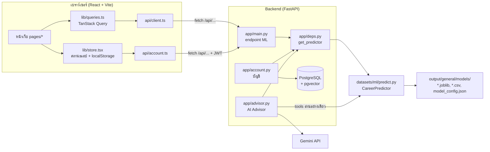
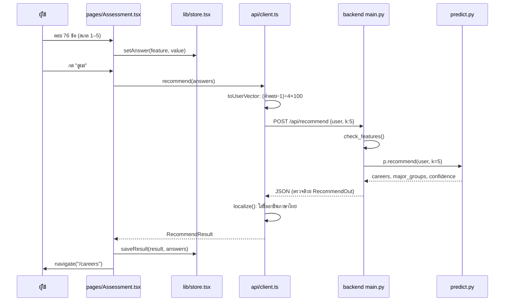
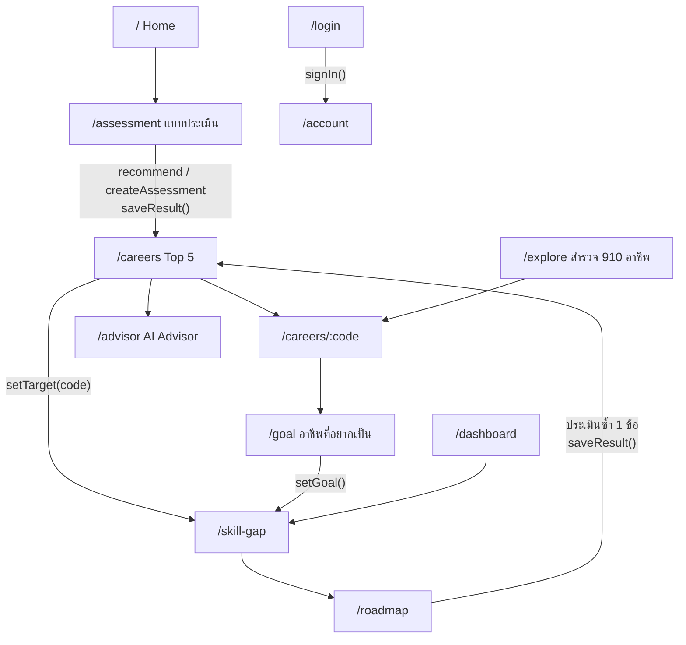
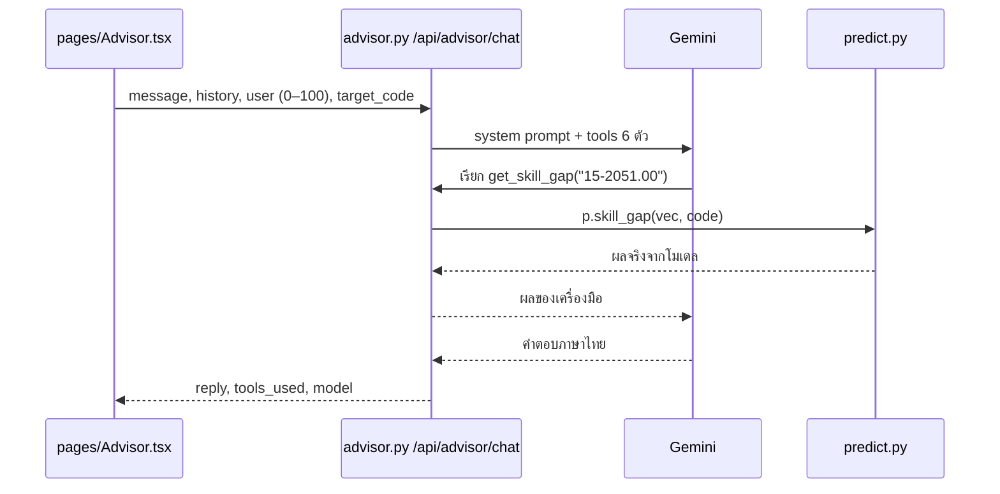
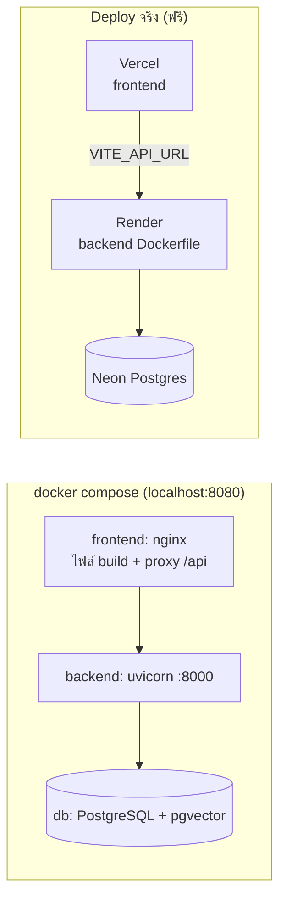

# อธิบายโค้ด CareerPath AI (Frontend + Backend)

เอกสารนี้อธิบายว่าโค้ดแต่ละส่วนคืออะไร ทำงานอย่างไร และ**เชื่อมกันอย่างไร** ตั้งแต่ผู้ใช้กดปุ่มบนหน้าเว็บ
จนถึงโมเดล ML คำนวณผลแล้วส่งกลับมาแสดง พร้อมตัวอย่างโค้ดจริงจากโปรเจกต์ (ตัดบางส่วนออกให้สั้นลง ใช้ `...` แทน)

> ตัวเลขความแม่นทั้งหมดในโปรเจกต์มาจาก **ผู้ใช้จำลอง** (โปรไฟล์อาชีพ + noise + bias) ไม่ใช่คนจริง

---

## สารบัญ

1. [ภาพรวมสถาปัตยกรรม](#1-ภาพรวมสถาปัตยกรรม)
2. [เส้นทางข้อมูลหลัก: ทำแบบประเมิน → ได้ Top 5](#2-เส้นทางข้อมูลหลัก-ทำแบบประเมิน--ได้-top-5)
3. [ชั้น ML: `predict.py` (CareerPredictor)](#3-ชั้น-ml-predictpy-careerpredictor)
4. [Backend (FastAPI)](#4-backend-fastapi)
5. [Frontend (React)](#5-frontend-react)
6. [ทีละหน้า: หน้าไหนเรียกอะไร](#6-ทีละหน้า-หน้าไหนเรียกอะไร)
7. [ระบบบัญชีและการซิงก์ข้อมูล](#7-ระบบบัญชีและการซิงก์ข้อมูล)
8. [AI Advisor (LLM อธิบายผล ML)](#8-ai-advisor-llm-อธิบายผล-ml)
9. [โหมดตัวอย่าง (ไม่มี backend)](#9-โหมดตัวอย่าง-ไม่มี-backend)
10. [การ Deploy และการรัน](#10-การ-deploy-และการรัน)
11. [ตาราง endpoint ทั้งหมด](#11-ตาราง-endpoint-ทั้งหมด)

---

## 1. ภาพรวมสถาปัตยกรรม



แบ่งเป็น 3 ชั้น:

| ชั้น | ที่อยู่ | หน้าที่ |
|---|---|---|
| **ML** | `datasets/ml/predict.py` | โหลดโมเดลที่เทรนแล้ว คำนวณ Top 5, Skill Gap, อธิบายผล, counterfactual |
| **Backend** | `backend/app/` | ห่อ ML เป็น REST API (`/api/...`), ระบบบัญชี (JWT + PostgreSQL), AI Advisor |
| **Frontend** | `frontend/src/` | หน้าเว็บ 12 หน้า, เก็บสถานะผู้ใช้, เรียก API, วาดกราฟ |

**หลักสำคัญ:** การคำนวณทุกอย่างเกิดใน `predict.py` ที่เดียว — backend แค่ตรวจ input แล้วส่งต่อ,
frontend แค่แสดงผล, LLM แค่อธิบายผล (ไม่คำนวณเอง)

---

## 2. เส้นทางข้อมูลหลัก: ทำแบบประเมิน → ได้ Top 5



### ขั้นที่ 1 — คำถามมาจากไฟล์ JSON

คำถาม 76 ข้อเก็บใน `frontend/src/data/questions.json` แต่ละข้อมี `feature` ที่ตรงกับ `feature_order` ของโมเดล:

```json
{
  "no": 1,
  "section": "1. ทักษะและความรู้",
  "feature": "grp::numbers",
  "question": "คำนวณ ใช้ตัวเลข และแก้โจทย์คณิตศาสตร์ได้ดีแค่ไหน",
  "scale": "1 = ไม่มีเลย … 5 = เชี่ยวชาญ"
}
```

คำนำหน้า feature บอกประเภท: `grp::` กลุ่มทักษะ (30) · `ri::` ความสนใจ RIASEC (6) · `gtask::` ลักษณะงานทั่วไป (18)
· `task::` งาน IT (12) · `ws::` นิสัยการทำงาน (10)

### ขั้นที่ 2 — แปลงคำตอบเป็นคะแนน 0–100 (`api/client.ts`)

```ts
/** แปลงคำตอบ 1–5 เป็นคะแนน 0–100: (คำตอบ − 1) ÷ 4 × 100 */
export function toUserVector(answers: Answers): UserVector {
  const v: UserVector = {};
  for (const [f, a] of Object.entries(answers)) v[f] = ((a - 1) / 4) * 100;
  return v;
}

export function recommend(answers: Answers, k = 5): Promise<RecommendResult> {
  if (IS_DEMO) return delay(SAMPLE.recommend, 700);   // โหมดตัวอย่าง
  return post("/recommend", { user: toUserVector(answers), k });
}
```

ตอบ 1 → 0, ตอบ 3 → 50, ตอบ 5 → 100 (สูตรเดียวกับที่ใช้เทรน — ห้ามเปลี่ยน)

### ขั้นที่ 3 — หน้า Assessment ส่งผล (`pages/Assessment.tsx`)

```tsx
const submit = useMutation({
  mutationFn: async () => {
    // เข้าสู่ระบบแล้ว: backend คำนวณและบันทึกผลในบัญชี · ยังไม่เข้า: คำนวณอย่างเดียว เก็บในเบราว์เซอร์
    const r = token
      ? (await createAssessment(token, answers)).result   // POST /api/assessments
      : await recommend(answers);                          // POST /api/recommend
    ...
    return r;
  },
  onSuccess: (r) => {
    saveResult(r, answers);   // เก็บผล + คำตอบชุดนี้ใน store
    nav("/careers");          // ไปหน้า Top 5
  },
});
```

### ขั้นที่ 4 — Backend รับ request (`backend/app/main.py`)

```python
@api.post("/recommend", response_model=RecommendOut)
def recommend(body: RecommendIn, p: CareerPredictor = Depends(get_predictor)):
    """① Cosine + ②a MLP → Ensemble Top-k, ②b กลุ่มอาชีพ, ③ คลัสเตอร์, ความมั่นใจ"""
    check_features(body.user, p)        # feature ที่ไม่รู้จัก → 422
    return p.recommend(body.user, k=body.k)
```

`RecommendIn` (ใน `schemas.py`) บังคับให้ทุกค่าอยู่ช่วง 0–100 ด้วย pydantic:

```python
Score = Annotated[float, Field(ge=0, le=100)]

class UserIn(BaseModel):
    user: dict[str, Score] = Field(min_length=1)

class RecommendIn(UserIn):
    k: int = Field(5, ge=1, le=20)
```

### ขั้นที่ 5 — หน้าอื่นใช้ผลเดียวกันต่อ

หลัง `saveResult` ทุกหน้า (Careers, Skill Gap, Roadmap, Dashboard, Advisor) อ่านผลจาก store ผ่าน hook `useResult()`
และเรียก API เพิ่มเติม (skill-gap, explain, similar) ด้วย **คำตอบชุดเดียวกัน** ที่สร้างผลนั้น (`resultAnswers`)

---

## 3. ชั้น ML: `predict.py` (CareerPredictor)

ไฟล์ `datasets/ml/predict.py` คือหัวใจของระบบ backend โหลดมันครั้งเดียวตอนเริ่มเซิร์ฟเวอร์

### 3.1 โหลดโมเดล (`__init__`)

```python
class CareerPredictor:
    def __init__(self, model_dir="output/models", meta_csv=None):
        d = Path(model_dir).resolve()
        self.cfg = json.loads((d / "model_config.json").read_text())
        self.features = self.cfg["feature_order"]                 # 76 feature
        self.codes = np.asarray(self.cfg["class_order"], dtype=object)  # 910 อาชีพ
        ref = pd.read_csv(d / "reference_vectors.csv", index_col=0)
        self.R = ref.loc[self.codes, self.features].to_numpy(float)     # เมทริกซ์ 910 × 76
        self.occ_clf = joblib.load(d / "occupation_classifier.joblib")  # ②a MLP
        self.grp_clf = joblib.load(d / "major_group_classifier.joblib") # ②b kNN
        self.clu = joblib.load(d / "clustering.joblib")                 # ③ K-Means
        ...
```

`self.R` = "โปรไฟล์อาชีพ" แต่ละแถวคือระดับที่อาชีพนั้นต้องการในแต่ละข้อ (0–100) จาก O*NET

### 3.2 แปลง input เป็นเวกเตอร์

```python
def _vector(self, user):
    """feature ที่ไม่ได้ตอบใช้ค่ากลาง 50"""
    missing = [f for f in self.features if f not in user]
    v = np.array([float(user.get(f, 50.0)) for f in self.features])
    return np.clip(v, 0, 100)[None, :], missing
```

### 3.3 สามโมเดล + Ensemble

```python
def matching_scores(self, X):            # ① Cosine — เทียบเวกเตอร์ผู้ใช้กับ 910 อาชีพ
    Q = self._l2(X)                      # ทำให้ยาว = 1
    return Q @ self.Rn.T                 # Rn = โปรไฟล์อาชีพที่ยาว = 1 แล้ว → ได้ cosine

def classifier_proba(self, X):           # ②a MLP — ความน่าจะเป็นของ 910 คลาส
    P = self.occ_clf.predict_proba(X)
    ...

def ensemble_scores(self, X):            # ① + ②a
    e = self.cfg["ensemble"]
    S = self.matching_scores(X)
    Z = (S - S.max(1, keepdims=True)) / e["softmax_T"]
    Pm = np.exp(Z); Pm /= Pm.sum(1, keepdims=True)   # softmax ให้ cosine กลายเป็นความน่าจะเป็น
    return e["w_matching"] * Pm + (1 - e["w_matching"]) * self.classifier_proba(X)  # 0.9 : 0.1
```

### 3.4 `recommend()` — สิ่งที่หน้า Careers ได้รับ

```python
def recommend(self, user, k=5):
    X, missing = self._vector(user)
    ens = self.ensemble_scores(X)[0]
    match = self.matching_scores(X)[0]
    clf = self.classifier_proba(X)[0]
    top = np.argsort(-ens)[:k]                     # จัดอันดับด้วย Ensemble
    gp = self.grp_clf.predict_proba(X)[0]          # ②b กลุ่มอาชีพ
    cover = self._coverage(X[0])                   # ทักษะครอบคลุม %
    return {
        "careers": [self._career_row(i, n + 1, cover, ens, match, clf) for n, i in enumerate(top)],
        "major_groups": [...],
        "missing_features": missing,
        "confidence": self._confidence(float(ens[top[0]]), bool(match.argmax() == clf.argmax())),
    }
```

**สำคัญ:** ตัวเลข % ที่แสดงใน Top 5 คือ `skill_coverage_percent` (**ทักษะครอบคลุม**) ไม่ใช่ % ความเหมาะ:

```python
def _coverage(self, x):
    """ผลรวม min(ผู้ใช้, ที่ต้องการ) ÷ ผลรวมที่ต้องการ (นับเฉพาะทักษะ)"""
    m = self.skill_mask
    return np.minimum(x[m], self.R[:, m]).sum(1) / self.R[:, m].sum(1).clip(1e-9) * 100
```

อันดับมาจาก Ensemble ส่วน % มาจากสูตรนี้ — อาชีพอันดับ 2 อาจมี % สูงกว่าอันดับ 1 ได้
หน้าเว็บจึงต้องมีป้ายกำกับเสมอ (`CoverageValue`, `RankNote` ใน `components/ui.tsx`)

### 3.5 `skill_gap()` — ทักษะที่ขาด + Skill Priority

```python
def skill_gap(self, user, code, k=10):
    """priority = gap × (1 + 0.5·O*NET importance + 0.5·distinctiveness)"""
    X, _ = self._vector(user)
    i = self.code_idx[code]
    req, usr = self.R[i], X[0]
    gap = np.clip(req - usr, 0, None)                       # ขาดเท่าไร (ไม่ติดลบ)
    imp = self.importance.loc[code].fillna(0).to_numpy() / 100
    z = np.clip((req - self.ref_mean) / self.ref_std, 0, 3) / 3   # อาชีพนี้ต้องการมากกว่าอาชีพทั่วไปแค่ไหน
    prio = w["gap"] * gap / 100 * (1 + w["onet_importance"] * imp + w["distinctiveness"] * z)
    ...
    return {"code": code, "title": ..., "skills_met": met, "skills_total": len(rows),
            "top_priorities": [...], "tools_used": tools, "all": rows}
```

### 3.6 `explain()` — ทำไมอาชีพนี้ขึ้นมา (แยกรายคำถาม)

```python
contrib = x * (self.Rn[i] - self.Rn.mean(0))
# Σ contribution = cos(ผู้ใช้, อาชีพนี้) − cos เฉลี่ยกับทุกอาชีพ  (แยกได้พอดี ไม่ใช่การประมาณ)
```

ค่าบวก = ข้อนี้ทำให้อาชีพนี้ได้คะแนนสูงกว่าอาชีพทั่วไป · ค่าลบ = ข้อนี้ดึงคะแนนลง
คืน `positive` 5 ข้อ, `negative` 5 ข้อ และ `by_domain` (รวมตามหมวด)

### 3.7 `target()` + `counterfactual()` — อาชีพที่อยากเป็น

ผู้ใช้เลือกอาชีพใดก็ได้จาก 910 → บอกอันดับปัจจุบัน + "ต้องเพิ่มทักษะอะไรน้อยที่สุดจึงเข้า Top 5"
ใช้ greedy: แต่ละรอบลองเพิ่มทุกทักษะ +25 (1 ระดับคำตอบ) แล้วเลือกตัวที่ช่วยมากที่สุด

```python
while rank > k and len(steps) < max_steps:
    cand = [j for j in skill if x[j] < 100 and req[j] > x[j]]   # ทักษะที่ยังต่ำกว่าที่อาชีพต้องการ
    Xc = np.repeat(x[None], len(cand), axis=0)
    for r, j in enumerate(cand):
        Xc[r, j] = float(np.clip(x[j] + 25, 0, 100))            # ลองเพิ่ม 1 ระดับ
    rk, mg = self._rank_and_margin(Xc, t, k)                    # อันดับใหม่ด้วย Ensemble ตัวเดิม
    b = int(np.argmax(mg))
    if mg[b] <= margin + 1e-9:
        break                                                   # เพิ่มอะไรก็ไม่ช่วยแล้ว
    ...
```

`target()` คืนทั้งแบบ `skills` (เพิ่มทักษะอย่างเดียว) และ `all` (ถ้าความชอบ/นิสัยตรงด้วย)

### 3.8 `similar_careers()` — อาชีพใกล้เคียง (③ K-Means)

```python
same = [c for c in self.codes if labels[c] == labels[code] and c != code]   # คลัสเตอร์เดียวกัน
sims = {c: float(self.Rn[self.code_idx[c]] @ self.Rn[i]) for c in same}    # เรียงตาม cosine
```

---

## 4. Backend (FastAPI)

```
backend/app/
├── main.py      แอป FastAPI + endpoint ML ทั้งหมด (/recommend, /skill-gap, /explain, /target, /careers ...)
├── deps.py      โหลด CareerPredictor ครั้งเดียว (lru_cache) + path ต่าง ๆ + อ่าน backend/.env
├── schemas.py   pydantic models ของ request/response (ตรงกับ frontend/src/api/types.ts)
├── account.py   สมัคร/ล็อกอิน (bcrypt + JWT) + เก็บข้อมูลผู้ใช้ใน DB
├── db.py        SQLAlchemy models + pgvector vector(76) + seed อาชีพ
└── advisor.py   AI Advisor: Gemini + เครื่องมือ 6 ตัวที่ห่อ predict.py
```

### 4.1 โหลดโมเดลครั้งเดียว (`deps.py`)

```python
ROOT = Path(__file__).resolve().parents[2]
load_dotenv(Path(__file__).resolve().parents[1] / ".env")
ML_DIR = Path(os.getenv("ML_DIR", ROOT / "datasets" / "ml"))
MODEL_DIR = Path(os.getenv("MODEL_DIR", ML_DIR / "output" / "general" / "models"))
sys.path.insert(0, str(ML_DIR))           # ให้ import predict ได้

from predict import CareerPredictor

@lru_cache(maxsize=1)
def get_predictor() -> CareerPredictor:
    """โหลดโมเดลครั้งเดียวต่อ process (~16 MB)"""
    return CareerPredictor(MODEL_DIR)
```

ทุก endpoint รับ predictor ผ่าน `Depends(get_predictor)` — ได้ object ตัวเดียวกันเสมอ

### 4.2 ตอนเริ่มแอป (`lifespan` ใน `main.py`)

```python
@asynccontextmanager
async def lifespan(_: FastAPI):
    p = get_predictor()            # โหลดตอนเริ่ม ไม่ให้ request แรกช้า
    if db.init_db():               # ไม่ตั้ง DATABASE_URL = ปิดระบบบัญชี ส่วนอื่นใช้ได้ปกติ
        db.check_dim(p)            # ตรวจว่า vector(76) ตรงกับจำนวน feature
        db.seed_careers(p)         # ใส่ 910 อาชีพลงตาราง careers
    yield
```

### 4.3 CORS + รวม router

```python
app.add_middleware(CORSMiddleware,
    allow_origins=[o.strip() for o in os.getenv("CORS_ORIGINS", "http://localhost:5173").split(",") if o.strip()],
    allow_origin_regex=os.getenv("CORS_ORIGIN_REGEX") or None, ...)

api = APIRouter(prefix="/api")
...
app.include_router(api)              # endpoint ML (main.py)
app.include_router(account_router)   # บัญชี (account.py)
app.include_router(advisor_router)   # AI Advisor (advisor.py)
```

### 4.4 ตรวจ input ก่อนส่งให้โมเดล

```python
def check_features(user: dict[str, float], p: CareerPredictor) -> None:
    unknown = sorted(set(user) - set(p.features))
    if unknown:
        raise HTTPException(422, f"ไม่รู้จัก feature: {', '.join(unknown[:5])}")

def check_code(code: str, p: CareerPredictor) -> None:
    if code not in p.code_idx:
        raise HTTPException(404, f"ไม่พบอาชีพ {code}")
```

### 4.5 endpoint ที่อ่านข้อมูลอาชีพ (ไม่ต้องใช้คำตอบผู้ใช้)

`GET /api/careers` (รายชื่อ 910 อาชีพ สำหรับหน้า Explore/Goal) และ `GET /api/careers/{code}` (รายละเอียด) อ่านจากไฟล์ของโมเดลตรง ๆ:

```python
@api.get("/careers", response_model=list[CareerListItem])
def careers(p: CareerPredictor = Depends(get_predictor)):
    ri = [j for j, f in enumerate(p.features) if f.startswith("ri::")]
    rows = []
    for i, c in enumerate(p.codes):
        top = sorted(ri, key=lambda j: -p.R[i, j])[:2]          # ความสนใจเด่น 2 ด้าน
        rows.append({"code": c, "title": p._title(c), "major": c[:2],
                     "cluster": int(p.clu["labels"][c]),
                     "riasec": [p.features[j].split("::")[1] for j in top]})
    return sorted(rows, key=lambda x: x["title"])
```

### 4.6 ผู้ใช้จริง + รายงานประเมินผล

- `POST /api/labels` — การ์ดไม่บังคับท้ายแบบประเมิน (คนทำงานบอกอาชีพจริง) → เก็บตาราง `real_labels` หรือไฟล์ `labels.jsonl`
- `GET /api/evaluation` — ใช้ `report.json` ที่ `evaluate.py` คำนวณไว้ + คำนวณส่วนผู้ใช้จริงสด (เพราะเครื่องฟรี 0.1 CPU รันใหม่ทั้งหมดไม่ไหว)

---

## 5. Frontend (React)

```
frontend/src/
├── main.tsx           จุดเริ่ม: QueryClientProvider → AppProvider → BrowserRouter → App
├── App.tsx            เส้นทาง (route) ทุกหน้า + lazy load
├── api/
│   ├── client.ts      เรียก endpoint ML + แปลงชื่อไทย + โหมดตัวอย่าง
│   ├── account.ts     เรียก endpoint บัญชี (แนบ JWT)
│   └── types.ts       TypeScript types (ตรงกับ backend/app/schemas.py)
├── lib/
│   ├── store.tsx      สถานะแอป (Context) + localStorage + ซิงก์ขึ้นบัญชี
│   ├── queries.ts     hook ดึงข้อมูล: useSkillGap, useExplain, useSimilar, useTarget ...
│   ├── useResult.ts   ผลประเมินปัจจุบัน (หรือผลตัวอย่างถ้ายังไม่ทำ) + อาชีพเป้าหมาย
│   ├── skills.ts      จัดสถานะทักษะ strong/near/missing และ tier high/mid/low
│   ├── labels.ts      ชื่อไทยของหมวด/กลุ่มอาชีพ/คลัสเตอร์/RIASEC
│   └── search.ts      ค้นอาชีพจากชื่อไทย/อังกฤษ/ชื่อเรียกอื่น
├── components/        Layout (เมนู), ui.tsx (ปุ่ม การ์ด CoverageValue ...), charts.tsx (ECharts),
│                      MlExplain (แผงอธิบายผล), AssessmentCards, RequireAuth, JobSearch ...
├── pages/             12 หน้า (ดูส่วนที่ 6)
└── data/              questions.json, sample_result.json, thai_titles.json, learning_resources.json
```

### 5.1 จุดเริ่ม (`main.tsx`)

```tsx
const queryClient = new QueryClient({ defaultOptions: { queries: { retry: 1, refetchOnWindowFocus: false } } })

createRoot(document.getElementById('root')!).render(
  <StrictMode>
    <QueryClientProvider client={queryClient}>   {/* cache ผล API */}
      <AppProvider>                              {/* สถานะผู้ใช้ (store.tsx) */}
        <BrowserRouter>
          <App />
        </BrowserRouter>
      </AppProvider>
    </QueryClientProvider>
  </StrictMode>,
)
```

### 5.2 เส้นทาง (`App.tsx`)

```tsx
const Careers = lazy(() => import('./pages/Careers'))   // โหลดโค้ดหน้าเมื่อเปิดหน้านั้นจริง
...
<Routes>
  <Route path="/login" element={<Suspense fallback={<Spinner />}><Login /></Suspense>} />
  <Route element={<Layout />}>                          {/* ทุกหน้าในนี้มีเมนูด้านบน */}
    <Route path="/" element={<Home />} />
    <Route path="/dashboard" element={<Dashboard />} />
    <Route path="/assessment" element={<Assessment />} />
    <Route path="/careers" element={<Careers />} />
    <Route path="/careers/:code" element={<CareerDetail />} />
    <Route path="/goal" element={<Goal />} />
    <Route path="/explore" element={<Explore />} />
    <Route path="/skill-gap" element={<SkillGap />} />
    <Route path="/roadmap" element={<Roadmap />} />
    <Route path="/advisor" element={<Advisor />} />
    <Route path="/account" element={<RequireAuth><Account /></RequireAuth>} />
    <Route path="*" element={<Home />} />
  </Route>
</Routes>
```

### 5.3 ชั้นเรียก API (`api/client.ts`)

ทุก request ผ่าน `post()` / `get()` ซึ่ง **แปลงชื่ออาชีพเป็นภาษาไทยจุดเดียว** ด้วย `localize()`:

```ts
async function post<T>(path: string, body: unknown, token?: string | null): Promise<T> {
  const res = await fetch(`${API_URL}${path}`, {
    method: "POST",
    headers: { "Content-Type": "application/json",
               ...(token ? { Authorization: `Bearer ${token}` } : {}) },
    body: JSON.stringify(body),
  });
  if (!res.ok) throw new Error(`${path} → HTTP ${res.status}`);
  return localize((await res.json()) as T);
}

/** ทุก object ที่มี code + title → title = ชื่อไทย, title_en = ชื่อ O*NET */
export function localize<T>(v: T): T {
  if (Array.isArray(v)) return v.map(localize) as T;
  if (v && typeof v === "object") {
    const o = Object.fromEntries(Object.entries(v).map(([k, x]) => [k, localize(x)]));
    if (typeof o.code === "string" && typeof o.title === "string" && TH[o.code] && o.title_en === undefined) {
      o.title_en = o.title;
      o.title = TH[o.code];
    }
    return o as T;
  }
  return v;
}
```

`API_URL` มาจาก `VITE_API_URL` — ตอน dev ตั้งเป็น `/api` แล้ว Vite proxy ส่งต่อไป `localhost:8000`:

```ts
// vite.config.ts
server: { proxy: { '/api': 'http://localhost:8000' } },
```

### 5.4 hook ดึงข้อมูล (`lib/queries.ts`)

ใช้ TanStack Query ให้ผล API ถูก cache — หลายหน้าที่ขอข้อมูลเดียวกันจะยิง request ครั้งเดียว:

```ts
const ansKey = (a: Record<string, number>) => JSON.stringify(Object.entries(a).sort())

/** คำตอบชุดเดียวกับที่สร้างผลอันดับ — ยังไม่เคยประเมินใช้คำตอบผู้ใช้ตัวอย่าง */
export function useResultAnswers() {
  const { result, resultAnswers } = useApp()
  return result && Object.keys(resultAnswers).length ? resultAnswers : SAMPLE_ANSWERS
}

export function useSkillGap(code: string | null) {
  const answers = useResultAnswers()
  return useQuery({
    queryKey: ['skill-gap', code, ansKey(answers)],   // เปลี่ยนอาชีพหรือคำตอบ = ขอใหม่
    queryFn: () => skillGap(answers, code!),
    enabled: !!code,
    staleTime: Infinity,                              // คำตอบเดิม = ผลเดิมเสมอ ไม่ต้องขอซ้ำ
  })
}
```

hook อื่นมีรูปแบบเดียวกัน: `useExplain`, `useAllExplains`, `useAllSkillGaps` (ทุกอาชีพใน Top 5),
`useSimilar`, `useTarget`, `useMajor`, `useCareerDetail`

### 5.5 ผลปัจจุบัน + อาชีพเป้าหมาย (`lib/useResult.ts`)

```ts
export function useResult() {
  const { result: stored, targetCode, goal: storedGoal } = useApp()
  const result = useMemo(() => (stored ? localize(stored) : null), [stored])
  const r = result ?? SAMPLE                       // ยังไม่ทำแบบประเมิน → ใช้ผลตัวอย่าง
  const inTop = targetCode ? r.careers.find((c) => c.code === targetCode) : undefined
  const fromGoal = !inTop && result && goal && goal.code === targetCode ? goal : undefined
  const target = inTop || fromGoal || r.careers[0] // อาชีพที่ Skill Gap/Roadmap วิเคราะห์
  return { result: r, isSample: !result, target, isGoal: !!fromGoal }
}
```

**`target` คือตัวเชื่อมหลายหน้าเข้าด้วยกัน:** เลือกอาชีพในหน้า Careers หรือ Goal → `setTarget(code)` →
หน้า Skill Gap, Roadmap, Dashboard, Advisor ใช้อาชีพนี้ทันที

### 5.6 จัดสถานะทักษะ (`lib/skills.ts`)

ไม่ได้คำนวณคะแนนใหม่ แค่จัดกลุ่มค่า `gap` / `priority` ที่ backend ส่งมา:

```ts
export const NEAR = 25   // 25 คะแนน = 1 ระดับของสเกล 1–5

export const statusOf = (r: Pick<SkillRow, 'gap'>): SkillStatus =>
  r.gap <= 0 ? 'strong' : r.gap <= NEAR ? 'near' : 'missing'

/** แบ่งทักษะที่ยังมี Gap เป็น 3 ช่วงเท่า ๆ กันตาม priority */
export function tiersOf(all: SkillRow[]): Record<string, Tier> {
  const gaps = all.filter((r) => r.gap > 0).sort((a, b) => b.priority - a.priority)
  const n = gaps.length
  return Object.fromEntries(gaps.map((r, i) => [r.feature, i < n / 3 ? 'high' : i < (2 * n) / 3 ? 'mid' : 'low']))
}
```

---

## 6. ทีละหน้า: หน้าไหนเรียกอะไร



| หน้า | ไฟล์ | อ่านจาก store | เรียก API / hook | โมเดลที่ใช้ |
|---|---|---|---|---|
| หน้าแรก | `pages/Home.tsx` | `useResult` (มีผลแล้วหรือยัง) | — (อ่าน `questions.json` นับข้อ) | — |
| แบบประเมิน | `pages/Assessment.tsx` | `answers`, `token` | `recommend` / `createAssessment`, `submitLabel` | ① ②a ②b |
| อาชีพที่แนะนำ | `pages/Careers.tsx` | `useResult`, `major` | `useAllExplains`, `useAllSkillGaps`, `useSimilar`, `useMajor` | ① ②a ②b ③ |
| รายละเอียดอาชีพ | `pages/CareerDetail.tsx` | `useResult` | `useCareerDetail`, `useSimilar`, `useSkillGap`, `useTarget` | ③ + Skill Priority |
| อาชีพที่อยากเป็น | `pages/Goal.tsx` | `goal`, `setGoal` | `listCareers`, `useTarget` | Ensemble + counterfactual |
| สำรวจอาชีพ | `pages/Explore.tsx` | — | `listCareers` (`GET /careers`) | ③ (กรองตามคลัสเตอร์) |
| Skill Gap | `pages/SkillGap.tsx` | `useResult().target` | `useSkillGap` | Skill Priority |
| Roadmap | `pages/Roadmap.tsx` | `roadmap`, `setRoadmapStatus`, `recordLearning` | `useSkillGap`, `recommend`/`createAssessment` (ประเมินซ้ำ) | Skill Priority |
| Dashboard | `pages/Dashboard.tsx` | `history`, `useResult` | `useSkillGap` | Skill Priority |
| AI Advisor | `pages/Advisor.tsx` | `conversations`, `useResult` | `advisorReply` (`POST /advisor/chat`) | ทุกตัวผ่านเครื่องมือ |
| เข้าสู่ระบบ | `pages/Login.tsx` | `signIn` | `login` / `register` | — |
| บัญชี | `pages/Account.tsx` | `user`, `learning` | `listAssessments`, `updateMe`, `listMajors` | — |

### 6.1 หน้า Careers — แสดง Top 5 พร้อมเหตุผล

ดึง explain + skill gap ของ **ทุกอาชีพใน Top 5 พร้อมกัน** (`useQueries`) เพื่อแสดงเหตุผลหลักใต้ชื่อแต่ละอาชีพ:

```tsx
const gapsQ = useAllSkillGaps(result.careers.map((c) => c.code))    // POST /api/skill-gap × 5
const similar = useSimilar(sel.code)                                // GET /api/careers/{code}/similar
const explain = useExplain(sel.code)                                // POST /api/explain (อาชีพที่เลือก)
const explains = useAllExplains(result.careers.map((c) => c.code))  // POST /api/explain × 5
```

กดเลือกอาชีพ → `setTarget(code)` → ไปหน้า Skill Gap ได้ทันที (ข้อมูลอยู่ใน cache แล้ว เพราะ queryKey เดียวกัน)

### 6.2 หน้า Skill Gap

```tsx
const { target } = useResult()
const gap = useSkillGap(target.code)          // ข้อมูลเดียวกับที่หน้า Careers โหลดไว้
const tiers = tiersOf(gap.data.all)           // แบ่ง high / mid / low
// แสดงทักษะเรียงตาม priority + filter ตามหมวด + กราฟ (ECharts) เชื่อมกับ filter
```

### 6.3 หน้า Roadmap — ประเมินซ้ำทีละทักษะ

แต่ละทักษะในแผนมีปุ่ม "ประเมินใหม่" ตอบใหม่ 1 ข้อ = สร้างผลประเมินชุดใหม่ทั้งชุด:

```tsx
const check = useMutation({
  mutationFn: async (n: number) => {
    const next = { ...base, [row.feature]: n };          // คำตอบเดิม + ข้อที่ประเมินใหม่
    const [r, g] = await Promise.all([
      token ? createAssessment(token, next).then((a) => a.result) : recommend(next),
      skillGap(next, code),
    ]);
    saveResult(r, next);   // Top 5, Skill Gap, Dashboard อัปเดตตามทั้งหมด
    return g.all.find((x) => x.feature === row.feature)!;
  },
  onSuccess: (r) => { if (r.gap <= 0) onPassed(); },   // ถึงเกณฑ์ → สถานะ "ผ่านเกณฑ์"
});
```

สถานะแต่ละรายการ (`todo` / `doing` / `done` / `passed`) เก็บใน `roadmap` ของ store, key = `"${code}|${itemId}"`
ครบทุกรายการ → `recordLearning()` บันทึกการเรียน (แสดงที่ /account)
แหล่งเรียนรู้มาจาก `data/learning_resources.json` (ยัง `verified=false` — ต้องให้คนตรวจ)

### 6.4 หน้า Goal — อาชีพที่อยากเป็น

ค้นจาก 910 อาชีพ (`listCareers` + `lib/search.ts`) → เลือก → `useTarget(code)` (`POST /api/target`) แสดง:
อันดับปัจจุบันใน 910, เหตุผล (explain), และ counterfactual 2 แบบ
กด "ตั้งเป็นเป้าหมาย" → `setGoal(career)` → Skill Gap/Roadmap ใช้อาชีพนี้แม้ไม่อยู่ใน Top 5

### 6.5 หน้า Account — ต้องเข้าสู่ระบบ (`components/RequireAuth.tsx`)

```tsx
export function RequireAuth({ children }: { children: ReactNode }) {
  const { user, token } = useApp()
  const loc = useLocation()
  if (IS_DEMO) return <EmptyState title="โหมดตัวอย่างไม่มีระบบบัญชี" ... />
  if (!user || !token)
    return <Navigate to={`/login?next=${encodeURIComponent(loc.pathname + loc.search)}`} replace />
  return <>{children}</>
}
```

---

## 7. ระบบบัญชีและการซิงก์ข้อมูล

### 7.1 store เก็บอะไร (`lib/store.tsx`)

```ts
interface AppState {
  user: User | null
  token: string | null          // JWT (เก็บแค่ user_id)
  remember: boolean             // "จดจำฉัน" — false = sessionStorage
  answers: Answers              // คำตอบที่กำลังกรอก
  result: RecommendResult | null
  resultAnswers: Answers        // คำตอบชุดที่สร้าง result (Skill Gap ต้องใช้ชุดเดียวกัน)
  targetCode: string | null     // อาชีพที่กำลังวิเคราะห์
  major: string | null          // สาขาที่จบ (ไม่บังคับ)
  goal: CareerResult | null     // อาชีพที่อยากเป็น (อาจไม่อยู่ใน Top 5)
  history: HistoryEntry[]       // ประวัติผลประเมิน (กราฟพัฒนาการ)
  conversations: Conversation[] // แชท AI Advisor
  roadmap: Record<string, RoadmapStatus>
  learning: LearningRecord[]
}
```

ทุกครั้งที่ state เปลี่ยน เขียนลงเบราว์เซอร์อัตโนมัติ:

```ts
useEffect(() => {
  const [keep, drop] = s.remember ? [localStorage, sessionStorage] : [sessionStorage, localStorage]
  keep.setItem(KEY, JSON.stringify(s))
  drop.removeItem(KEY)
}, [s])
```

### 7.2 สองโหมด: ยังไม่เข้าสู่ระบบ vs เข้าสู่ระบบแล้ว

| | ยังไม่เข้าสู่ระบบ | เข้าสู่ระบบแล้ว |
|---|---|---|
| เก็บที่ | localStorage เท่านั้น | PostgreSQL (localStorage เป็นแค่ cache) |
| ทำแบบประเมิน | `POST /api/recommend` | `POST /api/assessments` (backend คำนวณ + บันทึก) |
| เปลี่ยนเป้าหมาย/Roadmap/แชท | แค่ `patch()` | `patch()` + `push()` ส่งขึ้นเซิร์ฟเวอร์ |

```ts
/** ส่งการเปลี่ยนแปลงไปเซิร์ฟเวอร์ (ถ้าเข้าสู่ระบบ) — ล้มเหลวไม่ขวางการใช้งาน แต่แจ้งเตือน */
const push = useCallback((fn: (t: string) => Promise<unknown>) => {
  const t = token
  if (!t) return
  fn(t).then(() => setSyncError(null)).catch((e: unknown) => {
    if (e instanceof acc.ApiError && e.status === 401) {
      patch({ ...EMPTY })                       // token หมดอายุ → ออกจากระบบ
      setSyncError('เซสชันหมดอายุ — เข้าสู่ระบบใหม่เพื่อบันทึกข้อมูล')
    } else setSyncError(`บันทึกขึ้นบัญชีไม่สำเร็จ: ${(e as Error).message}`)
  })
}, [patch, token])

setTarget: (targetCode) => {
  patch({ targetCode })                                       // อัปเดตหน้าเว็บทันที
  push((t) => acc.putTargets(t, { target_code: targetCode })) // PUT /api/me/targets
},
```

### 7.3 ล็อกอินแล้วย้ายข้อมูลขึ้นบัญชี (`signIn`)

ถ้าบัญชีใหม่ยังไม่มีผลประเมิน แต่เบราว์เซอร์มี → ย้ายขึ้นทั้งหมด:

```ts
let st = await acc.getState(t)                       // GET /api/me/state
if (!st.latest && local.result && Object.keys(local.resultAnswers).length) {
  await acc.createAssessment(t, local.resultAnswers) // เซิร์ฟเวอร์คำนวณผลใหม่จากคำตอบ (ไม่เชื่อผลจาก client)
  await acc.putTargets(t, { ... })
  if (Object.keys(local.roadmap).length) await acc.putRoadmap(t, local.roadmap)
  for (const c of local.conversations) await acc.putConversation(t, c)
  for (const r of local.learning) await acc.putLearning(t, r)
  st = await acc.getState(t)
}
set((prev) => ({ ...fromServer({ ...st, user }, t, prev, true), remember }))
```

### 7.4 ฝั่ง backend: JWT + bcrypt (`account.py`)

```python
def make_token(user_id: int, remember: bool = True) -> str:
    """ไม่ติ๊ก "จดจำฉัน" = token อายุ 1 วัน · ติ๊ก = JWT_EXPIRE_DAYS (ค่าเริ่มต้น 14 วัน)"""
    days = float(os.getenv("JWT_EXPIRE_DAYS", "14")) if remember else 1.0
    payload = {"sub": str(user_id), "exp": datetime.now(timezone.utc) + timedelta(days=days)}
    return jwt.encode(payload, jwt_secret(), algorithm="HS256")

def current_user(s: S, authorization: Annotated[str | None, Header()] = None) -> db.User:
    if not authorization or not authorization.lower().startswith("bearer "):
        raise HTTPException(401, "ต้องเข้าสู่ระบบ")
    uid = int(jwt.decode(authorization[7:], jwt_secret(), algorithms=["HS256"])["sub"])
    ...
```

บันทึกผลประเมิน — **backend คำนวณเอง** ไม่รับ "ผล" จาก client:

```python
@router.post("/assessments", response_model=AssessmentOut, status_code=201)
def create_assessment(body: AssessmentIn, u: U, s: S):
    p = get_predictor()
    ...
    vec = {f: (body.answers[f] - 1) / 4 * 100 for f in p.features}  # สูตรเดียวกับ frontend
    result = p.recommend(vec, k=5)
    a = db.Assessment(user_id=u.id, answers=dict(body.answers),
                      user_vector=[vec[f] for f in p.features],      # เก็บเป็น vector(76)
                      result=result, top_code=result["careers"][0]["code"])
    s.add(a)
    ...   # คงเป้าหมายเดิมไว้ถ้ายังอยู่ใน Top 5 หรือเป็นอาชีพที่อยากเป็น
    s.commit()
```

### 7.5 ฐานข้อมูล (`db.py`)

ตารางหลัก: `users`, `careers`, `assessments`, `user_targets`, `roadmap_items`, `learning_records`,
`conversations` / `messages`, `real_labels` — เวกเตอร์ใช้ pgvector บน PostgreSQL และ JSON ตอนเทสต์ด้วย SQLite:

```python
class Vec(TypeDecorator):
    """vector(76) บน PostgreSQL (pgvector) · JSON list บนฐานข้อมูลอื่น (SQLite ตอนเทสต์)"""
    impl = JSON
    def load_dialect_impl(self, dialect):
        if dialect.name == "postgresql":
            from pgvector.sqlalchemy import Vector
            return dialect.type_descriptor(Vector(DIM))
        return dialect.type_descriptor(JSON())

class Assessment(Base):
    __tablename__ = "assessments"
    id: Mapped[int] = mapped_column(Integer, primary_key=True)
    user_id: Mapped[int] = mapped_column(ForeignKey("users.id", ondelete="CASCADE"), index=True)
    answers: Mapped[dict] = mapped_column(JSON)            # feature → 1..5
    user_vector: Mapped[list[float]] = mapped_column(Vec)  # 0–100 ตาม feature_order
    result: Mapped[dict] = mapped_column(JSON)             # recommend() ที่ backend คำนวณ
    ...
```

ไม่ตั้ง `DATABASE_URL` → `session()` คืน 503 ทุก endpoint บัญชี แต่ endpoint ML ยังใช้ได้ปกติ
คอลัมน์ที่เพิ่มทีหลังต้องใส่ใน `_LATE_COLUMNS` (เพราะ `create_all` ไม่แก้ตารางที่มีอยู่แล้ว)

---

## 8. AI Advisor (LLM อธิบายผล ML)



LLM **ไม่คำนวณเอง** — ต้องเรียกเครื่องมือที่ห่อ `predict.py` แบบอ่านอย่างเดียว:

```python
def make_tools(user: dict[str, float] | None):
    """สร้างเครื่องมือที่ผูกกับคำตอบของผู้ใช้คนนี้ — ทุกตัวเรียก predict.py แบบอ่านอย่างเดียว"""
    p = get_predictor()
    vec = None if user is None else {f: float(user.get(f, 0.0)) for f in p.features}

    def get_my_top_careers() -> dict:
        """ผลแนะนำอาชีพ Top 5 ของผู้ใช้จากโมเดล ML ..."""   # docstring = คำอธิบายที่ Gemini เห็น
        if vec is None:
            return no_assess
        r = p.recommend(vec, k=5)
        return {"top5": [...], "note_skill_coverage": "... ไม่ใช่ % ความเหมาะ", ...}
    ...
    return [get_my_top_careers, explain_career, get_skill_gap,
            check_target_career, get_career_info, search_careers]
```

`search_careers` ค้นชื่อตรงก่อน แล้วเติมด้วย embedding (`gemini-embedding-001`, cosine ใน numpy):

```python
hits = [c for c in kb.values() if q and (q in c["title_th"].lower() or q in c["title_en"].lower() ...)]
...
v = np.asarray(r.embeddings[0].values, dtype=np.float32)
s = X @ (v / np.linalg.norm(v))          # X = embedding อาชีพที่สร้างไว้ใน backend/data/advisor/
```

โควตาฟรีมักเต็ม/503 → ลองโมเดลสำรองตามลำดับ:

```python
for m in dict.fromkeys([MODEL, *FALLBACK_MODELS]):
    try:
        r, used_model = c.models.generate_content(model=m, contents=contents, config=config), m
        break
    except errors.ServerError as e:      # 503 / 504 → ลองโมเดลถัดไป
        last = e
    except errors.ClientError as e:
        if e.code in (404, 429):         # ไม่มีโมเดล / โควตาเต็ม → ลองถัดไป
            last = e
            continue
        raise HTTPException(502, ...)
```

ฝั่ง frontend: ไม่ตั้ง `GEMINI_API_KEY` (backend คืน 503) หรือโหมดตัวอย่าง → `advisorReply()` ใช้ `demoReply()`
สรุปจากผล ML ที่มีอยู่แทน หน้าเว็บแสดงว่าคำตอบมาจากเครื่องมือไหน (`tools_used`)

---

## 9. โหมดตัวอย่าง (ไม่มี backend)

ไม่ตั้ง `VITE_API_URL` → `IS_DEMO = true` ทุกฟังก์ชันใน `client.ts` คืนข้อมูลจาก `src/data/sample_result.json`
(ผลโมเดลจริงที่รันไว้กับผู้ใช้ตัวอย่าง สร้างด้วย `backend/scripts/make_sample_result.py`):

```ts
export const API_URL: string = import.meta.env.VITE_API_URL ?? "";
export const IS_DEMO = API_URL === "";

export function skillGap(answers: Answers, code: string, k = 10): Promise<SkillGapResult> {
  if (IS_DEMO) {
    const g = SAMPLE.skill_gaps[code];
    return g ? delay(g) : Promise.reject(new Error(`ไม่มีข้อมูลตัวอย่างของอาชีพ ${code}`));
  }
  return post("/skill-gap", { user: toUserVector(answers), code, k });
}
```

ผลจึง**ไม่เปลี่ยนตามคำตอบ** และไม่มีระบบบัญชี — ใช้ดูหน้าตาเว็บได้โดยไม่ต้องรัน Python
นอกจากนี้ แม้มี backend แต่ผู้ใช้ยังไม่ทำแบบประเมิน `useResult()` ก็ใช้ผลตัวอย่าง (`isSample = true`) และบางหน้า
แสดง `NeedAssessment` ชวนไปทำแบบประเมินแทน

---

## 10. การ Deploy และการรัน



nginx ใน docker-compose ส่ง `/api/` ต่อให้ backend (`frontend/nginx.conf`):

```nginx
location /api/ {
    proxy_pass http://backend:8000;
    # AI Advisor เรียกเครื่องมือหลายรอบ + อาจสลับโมเดลสำรอง — วัดได้ 70–160 วินาที
    proxy_read_timeout 300s;
}
```

| รัน | คำสั่ง |
|---|---|
| backend (dev) | `cd backend && .venv/bin/uvicorn app.main:app --reload --port 8000` |
| frontend (dev) | `cd frontend && npm run dev` (ตั้ง `VITE_API_URL=/api` ใน `.env.local`) |
| ทั้งหมดด้วย Docker | `docker compose up -d --build` → http://localhost:8080 |
| เทสต์ backend | `cd backend && .venv/bin/python -m pytest -q` |
| เทสต์ frontend | `cd frontend && npm run build` |

Deploy จริง: frontend บน Vercel deploy เองเมื่อ push · **backend บน Render ต้องกด Manual Deploy เอง** — ขั้นตอนใน [DEPLOY.md](DEPLOY.md)

---

## 11. ตาราง endpoint ทั้งหมด

### ML (`main.py`) — ไม่ต้องเข้าสู่ระบบ

| Method | Path | เรียก predict.py | ใช้ที่หน้า |
|---|---|---|---|
| GET | `/api/health` | — | ตรวจสถานะ |
| GET | `/api/features` | `p.features` | — |
| POST | `/api/recommend` | `recommend()` | Assessment, Roadmap (ประเมินซ้ำ) |
| POST | `/api/skill-gap` | `skill_gap()` | Careers, Skill Gap, Roadmap, Dashboard, CareerDetail |
| POST | `/api/explain` | `explain()` | Careers |
| POST | `/api/target` | `target()` | Goal, CareerDetail |
| GET | `/api/majors` · POST `/api/major` | `major_view()` | Careers (การ์ดสาขาที่จบ), Account |
| GET | `/api/careers` | อ่าน `R`, คลัสเตอร์ | Explore, Goal |
| GET | `/api/careers/{code}` | อ่าน `R`, importance, tools | CareerDetail |
| GET | `/api/careers/{code}/similar` | `similar_careers()` | Careers, CareerDetail |
| POST | `/api/labels` | — (เก็บข้อมูลผู้ใช้จริง) | Assessment (การ์ดไม่บังคับ) |
| GET | `/api/evaluation` | `evaluate.py` | รายงานผลโมเดล |

### บัญชี (`account.py`) — ต้องมี `Authorization: Bearer <JWT>` (ยกเว้น register/login)

| Method | Path | หน้าที่ |
|---|---|---|
| POST | `/api/auth/register` · `/api/auth/login` | สมัคร / เข้าสู่ระบบ → `{token, user}` |
| GET · PATCH · DELETE | `/api/me` | ดู / แก้ / ลบบัญชี |
| GET | `/api/me/state` | โหลดทุกอย่างของผู้ใช้ครั้งเดียว (ตอนเปิดแอป/ล็อกอิน) |
| POST · GET | `/api/assessments` · `/api/assessments/{id}` | บันทึก / ดูประวัติผลประเมิน |
| PUT | `/api/me/targets` | อาชีพเป้าหมาย, อาชีพที่อยากเป็น, สาขา |
| PUT | `/api/roadmap` | สถานะรายการ Roadmap |
| PUT · DELETE | `/api/learning/{code}` | บันทึกการเรียน |
| PUT · DELETE | `/api/conversations/{cid}` | ประวัติแชท AI Advisor |

### AI Advisor (`advisor.py`)

| Method | Path | หน้าที่ |
|---|---|---|
| POST | `/api/advisor/chat` | `{message, history, user, target_code}` → `{reply, tools_used, model}` |

---

### ข้อควรรู้เมื่อแก้โค้ด

- **แก้ schema ต้องแก้ 2 ที่:** `backend/app/schemas.py` และ `frontend/src/api/types.ts` ให้ตรงกัน
- **ห้ามเปลี่ยนคำถาม/สเกล/สูตร `(คำตอบ−1)÷4×100`** โดยไม่เทรนใหม่ — โมเดลเทรนกับชุดนี้
- **ชื่อไทยแปลงที่ `localize()` จุดเดียว** — อย่าแปลงซ้ำในหน้าเว็บ
- **% ใน Top 5 = ทักษะครอบคลุม** ต้องมีป้ายกำกับเสมอ
- `scikit-learn==1.9.1` ตรึงไว้ใน `requirements.txt` (เวอร์ชันที่ใช้เทรน)
- เทรนโมเดลใหม่ต้องรัน `evaluate.py` ด้วย (เทสต์ `test_precomputed_report_matches_models` ตรวจ)
